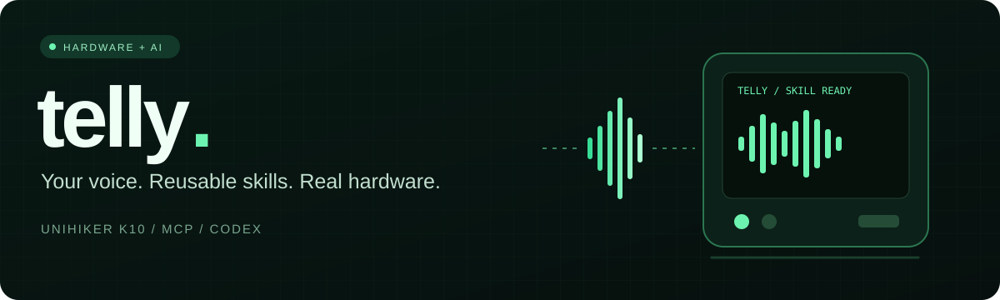
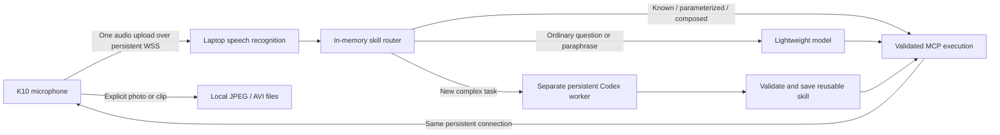

# Telly

[](https://github.com/vb3227/telly/actions/workflows/ci.yml)


[Install / Установка](docs/GETTING_STARTED_RU.md) · [Architecture](docs/ARCHITECTURE.md) · [Python skills](docs/PYTHON_SKILLS.md) · [Performance](docs/PERFORMANCE.md) · [Security](SECURITY.md)

**A voice-controlled MCP gateway for programmable hardware.**

Telly connects a UNIHIKER K10 to a laptop. Speak a command, reuse or combine existing skills, and let a coding worker create a reusable program when the task is genuinely new. The current implementation supports the K10 display, RGB LEDs, sensors, microphone and camera.

**Status: experimental hardware prototype.** Builds and automated tests are checked. Network reliability, recognition accuracy and complex-code latency still need real-world evaluation. Measured results and their limits are in [performance](docs/PERFORMANCE.md).

## What it does

- **A / A:** start and stop a bounded voice recording. **B is unassigned.**
- Reuse saved commands without model inference; combine known actions and change supported parameters without creating duplicates.
- Answer ordinary questions with one lightweight model call; send new complex programs to a separate Codex worker.
- Save genuinely new JSON skills in device NVS and laptop Python skills as source plus a manifest. Return short commands for future activation.
- Save a JPEG photograph or a silent, bounded MJPEG AVI clip on the laptop. No camera analysis, observation journal or person profiling.
- Run up to four cooperative device jobs and up to four restricted laptop Python workers, subject to shared hardware resources.
- Operate across client-isolated networks through one persistent, authenticated outbound WebSocket connection and a temporary HTTPS tunnel.

## Command examples

| Say after A | Behavior |
| --- | --- |
| `покажи датчики` / `show sensors` | Run the saved sensor skill |
| `мигни красным два раза` / `blink red twice` | Reuse the blink skill with count/color parameters |
| `show sensors and blink red twice` | Compose existing skills into one validated program |
| `сделай фото` / `take photo` | Save one JPEG |
| `запиши видео` / `record video` | Save a silent clip, up to ten seconds |
| `останови видео` / `stop video` | Finish an active recording |
| `Jarvis, покажи датчики` | The host accepts Jarvis as an optional command prefix |

The vendor on-device wake/phrase recognizer remains separate. Its installed model controls the actual wake word; accepting a host prefix does not retrain it to wake on Jarvis. Device-native short English phrases can run installed NVS skills without the laptop. Arbitrary speech, Russian aliases and laptop Python skills require the host.

## Architecture



The laptop sends recognized text directly to the router. It does not return text to the board for another upload. Commands and results share the persistent connection; the device does not hold a TLS lock while long-polling. Inference and media work do not block receipt of board responses.

## Quick start

**First installation:** follow the [complete Russian setup guide](docs/GETTING_STARTED_RU.md). It covers every credential, your own Codex account, first-time device skill installation, tunnel setup, daily startup and troubleshooting.

1. Install Python 3.11+, VS Code with PlatformIO, and a signed-in Codex CLI.
2. Create a virtual environment and install `requirements.txt`. Add `requirements-local-stt.txt` only for optional local Whisper recognition.
3. Copy `include/board_config.example.h` to ignored `include/board_config.h`, then set Wi-Fi credentials and matching random board/gateway tokens.
4. Configure the MCP facade with [config/mcp.example.toml](config/mcp.example.toml). Keep the Groq key on the laptop, in its environment or ignored private configuration.
5. Build and explicitly authorize Upload through VS Code. Start `python mcp/run_gateway.py --codex-config`.
6. For isolated networks start the tunnel helper and provision its address over USB as described in [setup](docs/SETUP.md).
7. On a fresh board, install the nine bundled JSON skills into device NVS before testing saved commands; the [first-run guide](docs/GETTING_STARTED_RU.md#15-установка-базовых-навыков-и-проверка-mcp) includes the exact MCP sequence.

Do not flash a board while it is driving equipment that cannot tolerate a restart. Platform-specific dependencies, model weights and credentials are not included in the source bundle.

## Extensibility and honest limits

Telly can generate new combinations and laptop logic **within the capabilities its firmware/API already exposes**. It cannot discover and control any arbitrary attached peripheral without drivers. A new camera interface, GPIO protocol or external actuator may require a firmware adapter, pin configuration and an authorized upload. Electrical compatibility and device drivers remain the developer's responsibility.

This makes Telly useful for robotics prototypes, classroom experiments, lab controls and reusable hardware workflows. It is not a plug-and-play universal hardware brain, a general Python interpreter on K10, or a hardened sandbox for hostile programs.

## Repository

| Path | Contents |
| --- | --- |
| `src/`, `include/` | C++ firmware and public board configuration template |
| `mcp/` | Stable MCP facade, realtime transport, speech and planning services |
| `skills/` | Canonical device skills and two reusable Python examples |
| `config/` | Portable MCP configuration example |
| `tests/` | Protocol, validation, composition and runtime tests |
| `scripts/` | Publication checks and source packaging |
| `docs/` | Setup, architecture, protocol, performance and boundaries |

```powershell
python -m pip install -r requirements-dev.txt
python -m unittest discover -s tests -t .
python scripts/check_repository.py
python scripts/package_source.py
```

Packaging produces `dist/telly-source.zip` from an explicit source manifest. Private credentials, media, models, logs, virtual environments and firmware binaries stay outside it. See [security](SECURITY.md), [Python skills](docs/PYTHON_SKILLS.md), [tests](docs/TESTING.md) and [GitHub description](docs/GITHUB_DESCRIPTION.md).

## Documentation

| Start here | What you will find |
| --- | --- |
| [Полная инструкция на русском](docs/GETTING_STARTED_RU.md) | Installation from GitHub, every key/token, your Codex account, first boot and troubleshooting |
| [Compact setup reference](docs/SETUP.md) | Gateway, network and firmware settings |
| [Architecture](docs/ARCHITECTURE.md) | Host, firmware and execution boundaries |
| [Speech](docs/SPEECH.md) | Groq and optional local CPU recognition |
| [Python skills](docs/PYTHON_SKILLS.md) | Persistent programs and the supported laptop API |
| [Testing](docs/TESTING.md) | Local validation and hardware checks |
| [Contributing](CONTRIBUTING.md) | Development workflow and review expectations |

## License

No redistribution license has been selected. Public source visibility does not grant an open-source license; agree on reuse and distribution terms with the owner.
