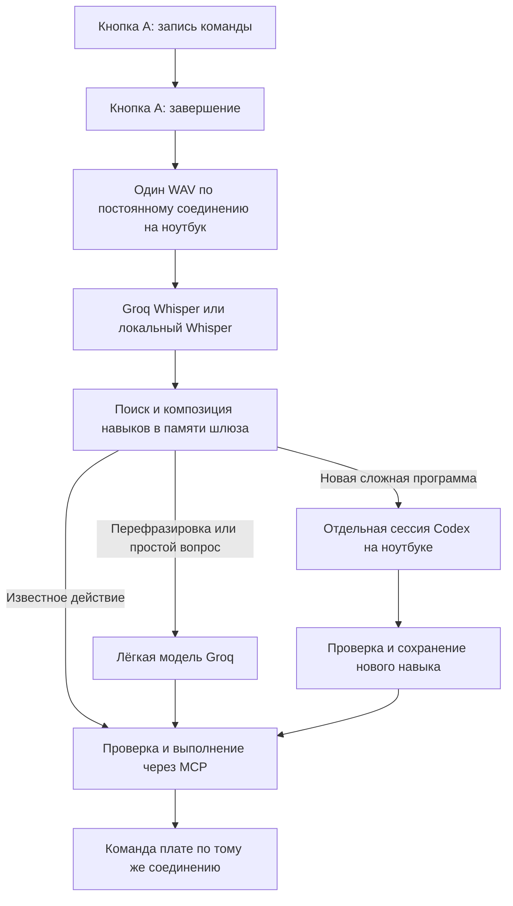

# Telly: полная установка с GitHub

Руководство для человека, который впервые скачал проект и хочет подключить свою UNIHIKER K10 к своему компьютеру и своему аккаунту Codex. Основной путь описан для Windows и PowerShell. Он соответствует исходному коду проекта на 2 ноября 2026 года.

Это экспериментальный проект: установка пока ручная. Одного файла прошивки недостаточно для произвольных голосовых запросов и генерации программ. Нужны прошивка **и работающий шлюз на ноутбуке**. Авторские ключи, Wi-Fi, история Codex, навыки из памяти чужой платы и виртуальные окружения в исходники не входят.

## Содержание

1. [Как устроена система](#1-как-устроена-система)
2. [Что понадобится](#2-что-понадобится)
3. [Скачивание проекта](#3-скачивание-проекта)
4. [Установка Python и зависимостей](#4-установка-python-и-зависимостей)
5. [Подключение собственного Codex](#5-подключение-собственного-codex)
6. [Получение ключа Groq](#6-получение-ключа-groq)
7. [Все секреты и настройки](#7-все-секреты-и-настройки)
8. [Настройка прошивки](#8-настройка-прошивки)
9. [Приватное окружение ноутбука](#9-приватное-окружение-ноутбука)
10. [Настройка MCP в Codex](#10-настройка-mcp-в-codex)
11. [Сборка и загрузка через VS Code](#11-сборка-и-загрузка-через-vs-code)
12. [Первый запуск шлюза](#12-первый-запуск-шлюза)
13. [Связь через разные сети](#13-связь-через-разные-сети)
14. [Альтернатива: доверенная локальная сеть](#14-альтернатива-доверенная-локальная-сеть)
15. [Установка базовых навыков и проверка MCP](#15-установка-базовых-навыков-и-проверка-mcp)
16. [Первый голосовой запрос](#16-первый-голосовой-запрос)
17. [Новые программы и короткие команды](#17-новые-программы-и-короткие-команды)
18. [Фото и видео](#18-фото-и-видео)
19. [Локальное распознавание речи](#19-локальное-распознавание-речи)
20. [Запуск на следующий день](#20-запуск-на-следующий-день)
21. [Полный справочник параметров](#21-полный-справочник-параметров)
22. [Диагностика](#22-диагностика)
23. [Обновление, перенос и резервные копии](#23-обновление-перенос-и-резервные-копии)
24. [Что можно публиковать](#24-что-можно-публиковать)
25. [Итоговая проверка установки](#25-итоговая-проверка-установки)

## 1. Как устроена система



Роли компонентов:

| Компонент | Зачем нужен | Где работает |
| --- | --- | --- |
| Прошивка C++ | Кнопки, микрофон, экран, датчики, камера, RGB и выполнение поддержанных операций | K10 |
| Шлюз `mcp/run_gateway.py` | Приём аудио, распознавание, маршрутизация, очередь задач, сохранение медиа | Компьютер |
| MCP-сервер `mcp/server.py` | Инструменты управления платой для Codex и шлюза | Компьютер |
| Codex CLI / App Server | Создание программ для новых сложных задач | Локальный процесс с обращением к сервису модели |
| Groq API | Распознавание по умолчанию и лёгкая модель маршрутизации/ответов | Внешний сервис |
| `cloudflared` | Временный адрес, доступный плате из другой сети | Компьютер + сервис Cloudflare |

Codex не встроен в микроконтроллер. Шлюз запускает `codex app-server --listen stdio://`, создаёт отдельную сессию и получает структурированный план. Затем код проекта проверяет план, сохраняет навык и выполняет его через MCP. Это не отправка сообщения в открытый чат автора проекта. Реализация: [codex_session.py](../mcp/codex_session.py), [codex_worker.py](../mcp/codex_worker.py); официальный протокол: [Codex App Server](https://learn.chatgpt.com/docs/app-server).

Существующий JSON-навык, его параметры и композиции часто обходятся без модели. Для новой Python-программы требуется ноутбук. Плата не исполняет произвольный Python и не получает новые аппаратные драйверы автоматически.

## 2. Что понадобится

### Оборудование

- Именно **UNIHIKER K10**. Инструкция не предназначена для Linux-версии UNIHIKER или произвольной ESP32.
- USB-кабель с передачей данных. Кабель только для зарядки не даст COM-порт.
- Компьютер Windows с доступом к Интернету.
- Доступная плате сеть Wi-Fi 2,4 ГГц с SSID и паролем.
- Для камеры — установленная совместимая камера K10.

Текущий код использует обычное подключение SSID/пароль. Для сети с веб-страницей входа, корпоративной авторизацией пользователя или обязательным сертификатом эта инструкция не обещает подключение. Сам факт подключения ноутбука к такой сети не означает, что K10 сможет войти в неё.

### Программы

| Программа | Назначение | Проверка |
| --- | --- | --- |
| Python 3.11+; для начала удобно 3.11 или 3.12 | Шлюз и MCP | `python --version` |
| VS Code | Открытие проекта и загрузка прошивки | Открывается папка с `platformio.ini` |
| PlatformIO IDE, расширение `platformio.platformio-ide` | Инструменты сборки и Upload | Видна панель PlatformIO |
| Codex CLI | Отдельный процесс генерации программ | `codex --version` |
| Git, по желанию | Клонирование и обновление | `git --version` |
| `cloudflared`, для рекомендуемого туннельного пути | Связь между разными сетями | `cloudflared --version` |

Официальные страницы установки: [Python](https://www.python.org/downloads/), [VS Code](https://code.visualstudio.com/), [PlatformIO IDE](https://docs.platformio.org/en/latest/integration/ide/vscode.html), [Codex CLI](https://learn.chatgpt.com/docs/cli), [cloudflared](https://developers.cloudflare.com/cloudflare-one/networks/connectors/cloudflare-tunnel/downloads/).

Зависимости платформы K10 скачиваются PlatformIO из источника, указанного в [platformio.ini](../platformio.ini). Первый запуск может быть долгим. Не начинайте Upload, пока установка инструментов не закончилась.

### Аккаунты

- Собственный вход в Codex с доступом к выбранной модели и доступными лимитами.
- Собственный API-ключ Groq для стандартной конфигурации.
- Для временного Quick Tunnel не требуется создавать постоянный домен. Это инструмент разработки, а не обещание доступности сервиса для продукта: [Cloudflare Quick Tunnels](https://developers.cloudflare.com/tunnel/get-started/quick-tunnels/).

## 3. Скачивание проекта

Через GitHub нажмите **Code → Download ZIP**, распакуйте архив и откройте полученную папку. Либо клонируйте адрес именно этого репозитория:

```powershell
git clone <URL-ЭТОГО-РЕПОЗИТОРИЯ> C:/projects/telly
Set-Location C:/projects/telly
```

`<URL-ЭТОГО-РЕПОЗИТОРИЯ>` — обозначение для замены, не буквальная команда. При скачивании ZIP команда `git clone` не нужна.

Дальше во всех примерах предполагается папка **`C:/projects/telly`**. Можно выбрать другой путь, но нужно заменить его во всех абсолютных путях конфигурации MCP.

Проверьте, что это корень проекта:

```powershell
Test-Path ./platformio.ini
Test-Path ./requirements.txt
Test-Path ./mcp/server.py
Test-Path ./include/board_config.example.h
```

Ожидается четыре `True`. Если нет — возможно, открыта внешняя папка архива, а сам проект находится на уровень глубже.

В VS Code выберите **File → Open Folder** и откройте эту же папку. Не создавайте второй пустой PlatformIO-проект поверх скачанного.

## 4. Установка Python и зависимостей

Установите Python, откройте новый PowerShell и проверьте:

```powershell
python --version
python -c "import sys; print(sys.executable)"
```

Если вместо Python открывается Microsoft Store, сначала исправьте установку/выбор интерпретатора. В Windows с Python Launcher можно использовать `py -3.12` вместо `python` при создании окружения, если установлена именно эта версия.

Создайте отдельное окружение в корне проекта:

```powershell
Set-Location C:/projects/telly
python -m venv .venv
.venv/Scripts/python.exe -m pip install -r requirements.txt
.venv/Scripts/python.exe -m pip check
```

Для последней команды ожидается `No broken requirements found.` Не заменяйте зависимости на случайные последние версии ради устранения одной ошибки. Прямые версии закреплены в [requirements.txt](../requirements.txt).

Проверка импортов без запуска шлюза:

```powershell
.venv/Scripts/python.exe -c "import mcp, httpx, PIL, serial, RestrictedPython, uvicorn, websockets; print('Runtime imports OK')"
```

Активировать `.venv` не обязательно: все команды в руководстве явно вызывают его `python.exe`. Поэтому для основного запуска не нужно менять системную Execution Policy ради `Activate.ps1`.

Не запускайте `python mcp/server.py` случайным глобальным Python, если пакеты установлены только в `.venv`.

## 5. Подключение собственного Codex

Установите **Codex CLI** по [официальной инструкции](https://learn.chatgpt.com/docs/cli). Одного установленного расширения VS Code недостаточно, если исполняемый файл CLI не доступен процессу Python.

В новом PowerShell:

```powershell
codex --version
codex login
codex login status
Get-Command codex
```

Завершите вход в браузере своим аккаунтом. Авторизация и доступные способы входа описаны в [документации OpenAI](https://learn.chatgpt.com/docs/auth). Доступ к моделям и лимиты зависят от аккаунта; это руководство не обещает бесплатную или неограниченную генерацию.

Важные особенности именно Telly:

- Рабочая сессия отдельная от чата, в котором вы настраиваете проект.
- По умолчанию используется `app-server`; не нужно запускать его вручную в отдельном окне.
- Если `TELLY_CODEX_MODEL` не задан, проект не фиксирует конкретное имя модели: используется выбор Codex.
- Настроить модель можно переменной `TELLY_CODEX_MODEL`, но только на доступный вашему аккаунту идентификатор.
- Шлюз удаляет `OPENAI_API_KEY` и `CODEX_API_KEY` из окружения запускаемого Codex. Основной путь — заранее выполненный вход CLI, а не вставка OpenAI-ключа в прошивку.
- Уже сохранённая авторизация самого CLI может иметь свой метод входа; проверьте его через `codex login status`.
- Ключ Groq не авторизует Codex. Это разные сервисы.

Если CLI находится вне `PATH`, задайте в приватном окружении `TELLY_CODEX_EXECUTABLE` полным путём к исполняемому файлу. При ошибке запуска Windows проверьте, что это рабочий исполняемый файл CLI, а не ярлык, файл установки или PowerShell-обёртка.

После установки CLI перезапустите терминалы и приложение Codex, если они были открыты до изменения `PATH`.

## 6. Получение ключа Groq

1. Откройте [Groq Console](https://console.groq.com/).
2. Создайте собственный API-ключ в разделе [API Keys](https://console.groq.com/keys).
3. Сохраните его локально, как описано в разделе 9.
4. Проверьте ограничения проекта, модели и доступный лимит в своём аккаунте.

В стандартной конфигурации один `GROQ_API_KEY` используется на ноутбуке для двух задач:

| Задача | Модель по умолчанию | Как меняется |
| --- | --- | --- |
| Распознавание WAV | `whisper-large-v3-turbo` | Выбор провайдера `local` вместо Groq; имя облачной speech-модели сейчас задано в исходнике |
| Перефразировки, простые планы и обычные ответы | `openai/gpt-oss-20b` | `TELLY_ROUTER_MODEL` |

Обратите внимание: `openai/gpt-oss-20b` здесь — идентификатор модели **в Groq**, он не требует OpenAI API-ключа для этого вызова.

Создание ключа и его передача через `GROQ_API_KEY`: [Groq Quickstart](https://console.groq.com/docs/quickstart). Поддержка Whisper Turbo: [Groq Speech to Text](https://console.groq.com/docs/speech-to-text).

Не вставляйте ключ в публичный README, коммит, скриншот или голосовую команду. Для новой установки не добавляйте его в C++-заголовок: плата напрямую к Groq больше не обращается. Старый приватный `#define GROQ_API_KEY` поддерживается загрузчиком только для совместимости с прежними установками.

## 7. Все секреты и настройки

### Что необходимо создать или получить самому

| Значение | Откуда взять | Где задать | С чем должно совпадать |
| --- | --- | --- | --- |
| `WIFI_SSID` | Название сети для платы | `include/board_config.h` | Имя доступной Wi-Fi сети |
| `WIFI_PASSWORD` | Пароль этой сети | `include/board_config.h` | Пароль точки доступа |
| `BOARD_TOKEN` | Сгенерировать случайно | `include/board_config.h` | `UNIHIKER_BOARD_TOKEN` на ноутбуке и в MCP |
| `VOICE_GATEWAY_TOKEN` | Сгенерировать второй случайный токен | `include/board_config.h` | `TELLY_VOICE_GATEWAY_TOKEN` на ноутбуке и в MCP |
| `GROQ_API_KEY` | Groq Console | Окружение процесса шлюза | Ваш действующий ключ Groq |
| Вход Codex | `codex login` | Хранилище авторизации CLI | Ваш аккаунт, доступные модели и лимиты |
| Адрес туннеля | Выведет `start_quick_tunnel.py` | USB-команда в K10, затем NVS | Текущий работающий туннель |

Токены платы и шлюза — это **не платные API-ключи**. Их генерируете вы. Используйте разные значения, например по 32 случайных байта:

```powershell
.venv/Scripts/python.exe -c "import secrets; print(secrets.token_urlsafe(32))"
.venv/Scripts/python.exe -c "import secrets; print(secrets.token_urlsafe(32))"
```

Первый результат используйте как токен платы, второй как токен шлюза. Вывод этих команд — секрет; не прикладывайте его к GitHub Issue.

Соответствие имён:

```text
board_config.h                    Ноутбук / MCP
-------------------------------   --------------------------------
BOARD_TOKEN                       UNIHIKER_BOARD_TOKEN
VOICE_GATEWAY_TOKEN               TELLY_VOICE_GATEWAY_TOKEN
```

### Что вручную не требуется

- API-ключ OpenAI для стандартного пути с заранее авторизованным Codex CLI.
- Ключ Cloudflare для используемого Quick Tunnel.
- Токен локального управления `TELLY_LOCAL_CONTROL_TOKEN`: шлюз создаёт его сам.
- Идентификатор чата Codex: отдельная сессия создаётся автоматически.
- IP платы для туннельного пути. Он нужен для диагностики, а не маршрутизации MCP через туннель.
- Пароли или токены автора репозитория.

## 8. Настройка прошивки

В корне проекта:

```powershell
Copy-Item ./include/board_config.example.h ./include/board_config.h
```

Команда предназначена для **первой установки**. Если приватный файл уже существует, сначала откройте его и сохраните нужные настройки; не перезаписывайте его вслепую.

Откройте `include/board_config.h` в редакторе и заполните:

```cpp
#pragma once

#define WIFI_SSID "YOUR_WIFI_NAME"
#define WIFI_PASSWORD "YOUR_WIFI_PASSWORD"
#define BOARD_TOKEN "PASTE_RANDOM_BOARD_TOKEN"

#define MAIN_PORT 8765
#define RESCUE_PORT 8766
#define SCREEN_DIR 2

// Для пути через туннель адрес будет передан позже по USB.
#define VOICE_GATEWAY_URL ""
#define VOICE_GATEWAY_TOKEN "PASTE_RANDOM_GATEWAY_TOKEN"
```

Все `YOUR_...` и `PASTE_...` нужно заменить. Кавычки C++ сохраните. Если SSID или пароль содержит `"` или `\`, экранируйте их как C++-строку.

`VOICE_GATEWAY_URL` при туннельной установке можно оставить пустым: после запуска туннельного помощника адрес попадёт в NVS. До передачи адреса плата не сможет связаться с ноутбуком, даже если Wi-Fi уже подключён.

Для прямой локальной сети адрес настраивается иначе — см. раздел 14. Не записывайте `localhost` или `127.0.0.1` как адрес ноутбука в прошивке: для платы это она сама.

Изменение Wi-Fi, встроенного токена, портов или `SCREEN_DIR` требует новой сборки и загрузки. Изменение временного адреса туннеля не требует перепрошивки.

## 9. Приватное окружение ноутбука

Рекомендуемый основной путь: **отдельный шлюз в PowerShell**, а Codex MCP подключается к уже работающему шлюзу. Так его логи видны, а закрытие одного чата не является штатным способом останавливать голосовой сервис.

Создайте игнорируемую папку:

```powershell
New-Item -ItemType Directory -Force .telly | Out-Null
```

В редакторе создайте **`.telly/user-env.ps1`** со следующим содержимым:

```powershell
# Приватный файл. Не публиковать.
$env:PYTHONUTF8 = '1'
$env:UNIHIKER_CONNECTION = 'relay'
$env:UNIHIKER_BOARD_TOKEN = 'PASTE_RANDOM_BOARD_TOKEN'
$env:TELLY_VOICE_GATEWAY_TOKEN = 'PASTE_RANDOM_GATEWAY_TOKEN'
$env:GROQ_API_KEY = 'PASTE_YOUR_GROQ_KEY'

$env:TELLY_VOICE_GATEWAY_PORT = '8767'
$env:TELLY_VOICE_GATEWAY_BIND = '127.0.0.1'
$env:TELLY_STT_PROVIDER = 'groq'
$env:TELLY_ROUTER_MODEL = 'openai/gpt-oss-20b'
$env:TELLY_CODEX_EFFORT = 'low'

# Необязательно. Раскомментировать только при необходимости:
# $env:TELLY_CODEX_EXECUTABLE = 'C:/tools/codex.exe'
# $env:TELLY_CODEX_MODEL = 'EXACT_MODEL_ID_AVAILABLE_TO_YOU'
# $env:TELLY_CODEX_TIMEOUT = '120'
```

Секреты замените своими. Токены должны **побайтно совпадать** с прошивкой: без добавочных пробелов и переводов строки.

Загрузите настройки в текущий PowerShell:

```powershell
. ./.telly/user-env.ps1
```

Первая точка и пробел обязательны: это загрузка переменных в текущую сессию. Файл не запускается автоматически при открытии проекта.

Если PowerShell блокирует именно ваш локальный файл, можно открыть его в редакторе и выполнить строки `$env:...` вручную в текущем терминале. Глобальное ослабление Execution Policy для проекта не требуется.

Проверка **наличия**, без вывода значений:

```powershell
.venv/Scripts/python.exe -c "import os; names=['UNIHIKER_BOARD_TOKEN','TELLY_VOICE_GATEWAY_TOKEN','GROQ_API_KEY']; print({n:bool(os.environ.get(n,'').strip()) for n in names})"
```

Ожидается `True` для всех трёх в стандартном режиме. Это не проверка баланса и не подтверждение правильности API-ключа.

**Файл `.env` автоматически не читается.** Само создание `.env` или вставка ключа в произвольный JSON не передаст его процессу шлюза.

Терминалы имеют независимые окружения. Переменные, заданные в одном окне, не появляются в другом уже открытом окне или приложении Codex. Для каждого ручного запуска шлюза загрузите этот файл в том же терминале.

## 10. Настройка MCP в Codex

Откройте пользовательский файл конфигурации Codex:

```powershell
Join-Path $env:USERPROFILE '.codex/config.toml'
```

Команда только показывает путь. Откройте полученный файл редактором. Если файла или каталога ещё нет, создайте их. Существующий `config.toml` **не заменяйте целиком**: добавьте секцию Telly, сохранив остальные настройки.

Пример для пути из этого руководства:

```toml
[mcp_servers.esp32-school-robot]
command = "C:/projects/telly/.venv/Scripts/python.exe"
args = ["C:/projects/telly/mcp/server.py"]

[mcp_servers.esp32-school-robot.env]
UNIHIKER_CONNECTION = "relay"
UNIHIKER_BOARD_TOKEN = "PASTE_RANDOM_BOARD_TOKEN"
TELLY_VOICE_GATEWAY_TOKEN = "PASTE_RANDOM_GATEWAY_TOKEN"
```

Готовая основа: [config/mcp.example.toml](../config/mcp.example.toml).

Проверьте:

- Путь указывает на **ваш** клон, не на компьютер автора.
- `command` указывает на Python того окружения, куда установлен `requirements.txt`.
- В TOML удобно писать пути через `/`; обратный слеш в обычных двойных кавычках требует экранирования.
- Имя секции остаётся `esp32-school-robot`: помощник `--codex-config` ищет именно его.
- Нет второй такой же TOML-секции. Повтор одной таблицы — ошибка разбора.
- Значения двух токенов совпадают с прошивкой и приватным окружением шлюза.

Проверка синтаксиса TOML без печати содержимого:

```powershell
.venv/Scripts/python.exe -c "import os,tomllib; from pathlib import Path; p=Path(os.environ['USERPROFILE'])/'.codex/config.toml'; tomllib.loads(p.read_text(encoding='utf-8')); print('TOML syntax OK')"
```

После изменения конфигурации перезапустите подключение MCP в клиенте или приложение Codex. Названия кнопок интерфейса зависят от версии. Проверяйте доступность инструментов `ping_unihiker` и `list_unihiker_skills`, а не только наличие записи в файле.

### Два способа запуска и их различия

| Способ | Кто запускает шлюз | Где нужны Groq и остальные настройки |
| --- | --- | --- |
| Рекомендуемый: сначала отдельный `run_gateway.py`, затем MCP | Ваш PowerShell | В окружении этого PowerShell; MCP использует уже работающий шлюз |
| Автозапуск через `server.py`, если отдельного шлюза нет | Клиент MCP | В окружении запускаемого MCP-процесса; например, в его TOML-секции `env` |

Во втором варианте добавьте в MCP `env` собственный `GROQ_API_KEY` и нужные параметры моделей. Если ключа нет и выбран Groq STT, запуск завершится ошибкой. Окружение отдельного терминала не гарантированно наследуется приложением Codex.

`run_gateway.py --codex-config` импортирует из TOML **только** `UNIHIKER_CONNECTION`, `UNIHIKER_BOARD_TOKEN`, `TELLY_VOICE_GATEWAY_TOKEN`. Он **не импортирует** оттуда `GROQ_API_KEY`, пути, bind, порт или модель. Уже заданные переменные окружения имеют приоритет. Поэтому основной путь этого руководства явно загружает `.telly/user-env.ps1`.

Не запускайте одновременно два независимых шлюза. Шлюз один, клиентов MCP может быть несколько.

## 11. Сборка и загрузка через VS Code

### Подготовка

1. Подключите K10 кабелем данных.
2. В VS Code откройте корень проекта, где лежит `platformio.ini`.
3. Установите PlatformIO IDE и дождитесь загрузки платформы, framework и библиотек.
4. Закройте Serial Monitor и любые другие программы, использующие COM-порт.
5. Проверьте заполнение приватного `board_config.h`.

Список портов можно посмотреть без изменения платы:

```powershell
.venv/Scripts/python.exe -m serial.tools.list_ports
```

Запишите свой порт, например `COM5`. Пример `COM5` в этом документе нужно заменить вашим значением. После переключения в загрузчик Windows может назначить другой порт.

### Сборка

В PlatformIO выберите окружение **`unihiker`**, запустите **Build**. Убедитесь, что в конце есть `[SUCCESS]`.

Сборка не означает загрузку: файл прошивки мог успешно создаться, а плата всё ещё выполнять старый код.

### Первая установка модели локального ASR

Окружение `unihiker` использует `Model=None`, сохраняя раздел модели распознавания. Если плата новая, модель отсутствует или Serial пишет:

```text
[asr] English wake/command model missing
```

выберите **`unihiker_model_en`** и выполните **Upload один раз**. Это отдельная загрузка firmware и английской модели из установленного vendor framework. После успеха верните выбор на **`unihiker`** для обычных последующих обновлений.

Если на плате уже правильная совместимая модель, загрузка `unihiker_model_en` при каждом изменении кода не нужна. Локальное ASR и распознавание WAV на ноутбуке — разные системы.

### Загрузка

Проверьте выбранный порт и окружение, затем нажмите **Upload** в VS Code. Дождитесь успешного завершения записи и проверки. Не отключайте USB во время записи.

Откройте Serial Monitor на **115200 baud**. Проверьте Wi-Fi/IP и готовность ASR. Если модель пока не загружена, штатная проверка должна оставить сеть доступной вместо входа в несовместимый vendor ASR.

Не меняйте скорость Upload, разметку flash и framework наугад. Ошибка доступа к порту обычно требует закрыть владельца COM-порта, а не переписывать код.

## 12. Первый запуск шлюза

Откройте отдельный PowerShell **из корня проекта**:

```powershell
Set-Location C:/projects/telly
. ./.telly/user-env.ps1
.venv/Scripts/python.exe mcp/run_gateway.py --codex-config
```

Оставьте окно открытым. В стандартном режиме должны появиться сообщение `speech_ready` с провайдером `groq` и сообщение запуска Telly. Первый запуск Codex может прогреваться отдельно.

В другом терминале:

```powershell
Invoke-RestMethod http://127.0.0.1:8767/health | ConvertTo-Json -Depth 6
```

Основные поля:

| Поле | Ожидание | Что оно действительно подтверждает |
| --- | --- | --- |
| `ready` | `true` | HTTP-шлюз отвечает |
| `transport` | `websocket` | Используется текущая архитектура |
| `provider` | `codex` | Выбран backend планирования, **не** успешный вход/готовность Codex |
| `transcription_provider` | `groq` или `local` | Выбранный провайдер речи |
| `api_key_configured` | `true` для стандартной установки | Ключ найден; баланс/доступ не проверены |
| `device_connected` | Пока может быть `false` | Только `true` подтверждает подключённую сессию платы |
| `queued` | Обычно `0` без запросов | Количество ожидающих задач быстрой очереди |
| `last_request` | Может быть пустым | Метрики последнего обработанного запроса |

`/health` с HTTP 200 сам по себе не означает, что плата доступна или что Codex успешно сгенерирует код. До настройки адреса туннеля `device_connected=false` ожидаем.

Если при запуске написано `gateway disabled: set TELLY_VOICE_GATEWAY_TOKEN`, исправьте окружение. Не считайте одну строку `running` доказательством работоспособности: проверяйте `/health`.

## 13. Связь через разные сети

Это рекомендуемый путь для школьного Wi-Fi с изоляцией клиентов, хот-спота или разных сетей. Плата устанавливает **исходящее** защищённое соединение к временному адресу. Ноутбук и плата должны иметь доступ в Интернет, но не обязаны видеть друг друга по локальному IP.

### Установить cloudflared

Скачайте Windows-версию по [официальной странице загрузки](https://developers.cloudflare.com/cloudflare-one/networks/connectors/cloudflare-tunnel/downloads/). Проверьте:

```powershell
cloudflared --version
```

Если программа не в `PATH`, помощник принимает `--cloudflared` с полным путём. Его встроенный запасной путь Windows — `C:/Program Files (x86)/cloudflared/cloudflared.exe`; фактическая установка может находиться в другом месте.

### Запустить туннель и передать адрес

1. Шлюз из раздела 12 должен уже работать.
2. Плата включена и подключена к своей Wi-Fi сети.
3. **Закройте Serial Monitor**, чтобы освободить COM-порт.
4. Во втором терминале запустите:

```powershell
Set-Location C:/projects/telly
.venv/Scripts/python.exe mcp/start_quick_tunnel.py --port COM5 --protocol http2
```

При отдельном исполняемом файле:

```powershell
.venv/Scripts/python.exe mcp/start_quick_tunnel.py --port COM5 --protocol http2 --cloudflared C:/tools/cloudflared.exe
```

Не запускайте оба примера одновременно. Выберите один. `http2` полезен там, где UDP мешает установлению QUIC-соединения; блокировка исходящего TCP самим сетевым администратором этим не обходится.

Ожидаемые подтверждения:

```text
Temporary relay URL: https://<generated-name>.trycloudflare.com
Board saved URL through COM5.
Tunnel is active; press Ctrl+C to stop it.
```

Помощник передаёт текущее Unix-время и адрес туннеля по USB. Адрес сохраняется в NVS. Держите это окно открытым.

Повторите `/health`: после установления WSS-сессии должно стать `device_connected=true`.

### Если автоматическая USB-настройка не прошла

Не закрывая работающий туннель, откройте Serial Monitor 115200 baud, включите завершение строки LF и отправьте адрес, напечатанный **вашим текущим** помощником:

```text
TELLY_RELAY_URL https://<generated-name>.trycloudflare.com
TELLY_STATUS
```

Строка `<generated-name>` — обозначение, её нельзя отправлять буквально. Требуется подтверждение `Relay URL saved: ...`. Сообщение `active but NOT persisted` означает, что адрес активен в RAM, но запись NVS не удалась; после перезагрузки он может пропасть.

Если часы платы не установились, получите время на ноутбуке:

```powershell
.venv/Scripts/python.exe -c "import time; print(int(time.time()))"
```

Отправьте в Serial `TELLY_TIME ` и полученное число. Ожидается `Relay clock synchronized`. Это помогает TLS, если NTP в сети недоступен.

### Ограничения этого пути

- Новый запуск Quick Tunnel обычно создаёт новый адрес. Его нужно снова передать плате по USB; перепрошивка не нужна.
- Старый адрес не начинает вести в новый туннель сам.
- Текущая проверка URL в прошивке допускает только `https://<name>.trycloudflare.com`, до 128 символов. Произвольный домен или named tunnel нельзя считать поддержанным простой заменой строки.
- Постоянный адрес и автоматическое обнаружение нового туннеля в этом пути не реализованы.
- Остановка помощника закрывает туннель; закрытие крышки/сон компьютера тоже может прервать связь.
- ICMP `ping` до IP платы может быть заблокирован сетью. Для этой архитектуры важнее `device_connected` и MCP `ping_unihiker`.
- Не отключайте системный firewall ради туннеля. Он не требует проброса входящего порта роутера к ноутбуку.

## 14. Альтернатива: доверенная локальная сеть

Используйте только если плата может напрямую обратиться к компьютеру и вы доверяете локальной сети. Соединение в этом варианте **plain WS**, без TLS; это не режим для публичного Wi-Fi.

1. Определите IPv4 компьютера на нужном адаптере через `ipconfig`.
2. В приватном `board_config.h` задайте `VOICE_GATEWAY_URL` как `http://<LAPTOP-LAN-IP>:8767`, заменив обозначение реальным IP.
3. В `.telly/user-env.ps1` замените `TELLY_VOICE_GATEWAY_BIND` на `0.0.0.0`.
4. Оставьте `UNIHIKER_CONNECTION='relay'`: здесь тоже используется постоянный WebSocket, а не прямые REST-запросы MCP к плате.
5. Загрузите изменённую прошивку через VS Code и перезапустите шлюз с новым окружением.
6. Если раньше был настроен туннель, отправьте в Serial `TELLY_RELAY_CLEAR`: сохранённый NVS-адрес имеет приоритет над встроенным LAN-адресом.
7. При необходимости разрешите только входящий TCP выбранного порта для нужной доверенной сети средствами Windows Firewall. Не выключайте firewall целиком.

При смене IP ноутбука встроенный LAN-адрес потребует обновления; для разработки удобнее туннельный путь. Порты 8765/8766 принадлежат HTTP-серверам **платы**, а 8767/8768 — сервисам **ноутбука**. Они не взаимозаменяемы.

`UNIHIKER_CONNECTION=direct` — отдельный путь прямых MCP HTTP-вызовов к плате. Сам по себе он не заменяет канал передачи голоса на ноутбук. Для первого полного голосового запуска придерживайтесь описанного `relay`.

## 15. Установка базовых навыков и проверка MCP

Файлы из `skills/` не попадают в NVS новой платы автоматически от скачивания ZIP. Для известного навыка шлюз может выбрать запуск уже сохранённого имени, поэтому первичную установку нельзя пропускать.

Когда `/health` показывает `device_connected=true`, откройте Codex с настроенным MCP и попросите:

> Используй MCP esp32-school-robot. Вызови ping_unihiker, затем list_unihiker_skills. Не прошивай плату.

Ожидается `pong` и список сохранённых имён. Пустой список на новой плате допустим, но затем установите базовые навыки:

> Через install_unihiker_skill установи по одному навыки blink, lights_on, lights_off, camera_on, camera_off, show_sensors, take_photo, record_video и stop_video. Не запускай их при установке. После этого вызови list_unihiker_skills и проверь, что все девять имён присутствуют.

Установка каждого навыка должна вернуть успешное сохранение. В списке должны быть все девять. Ошибку сохранения, в том числе 507/NVS, нельзя считать успехом.

Проверьте действия по одному:

> Через run_stored_unihiker_skill запусти show_sensors.

> Через run_stored_unihiker_skill запусти lights_on, затем lights_off.

Если нужно установить и сразу выполнить один навык, есть `run_unihiker_skill`. Для повторных запусков уже установленного — `run_stored_unihiker_skill`, чтобы не делать повторную запись в NVS.

Проверка параметризованного действия через MCP без модели:

```json
{
  "code": "{\"steps\":[{\"op\":\"rgb.blink\",\"r\":40,\"g\":0,\"b\":0,\"count\":2,\"period_ms\":250}]}"
}
```

Это аргументы `execute_board_code`, а не текст для Serial. Полученный `job_id` проверяйте через `board_job_status(job_id=...)`. Принятая задача ещё не означает завершённую задачу.

### Локальные фразы и ограничение ASR

Актуальный предел регистрации дополнительных локальных голосовых навыков в `main.cpp` — **8**. Это не предел общего числа файлов в каталоге и не предел ручных голосовых команд после A/A. У девятого сохранённого навыка может не оказаться собственного слота в vendor ASR. Не полагайтесь только на общее поле `voice_registered` как на доказательство распознавания конкретной фразы; проверяйте её произнесением.

Короткие английские фразы NVS могут исполняться локально. Русские варианты и Python-навыки требуют распознавания/маршрутизации на ноутбуке. Наличие префикса `Jarvis` у хоста не меняет wake word модели на плате.

## 16. Первый голосовой запрос

До голосовой проверки должны работать `/health`, `ping_unihiker` и запуск готового навыка через MCP.

1. Нажмите **A**: начинается запись.
2. Скажите: **«покажи датчики»** или **“show sensors”**.
3. Нажмите **A** ещё раз: запись завершается и отправляется на распознавание.
4. Проверьте транскрипт в Serial/логах шлюза.
5. Проверьте изменение экрана.

Кнопка B в текущем проекте свободна. A+B и двойные нажатия не являются режимом анализа видео. Максимальный аудиофрагмент — десять секунд. Завершайте запись вторым A; не ожидайте прежнего автоматического окончания по паузе или старого режима непрерывного прослушивания.

Для пути A/A произносите команду **без “Hi Telly”**. Эта фраза принадлежит отдельному локальному ASR; ручной транскрипт с ней может быть намеренно исключён из облачного пути во избежание двойного исполнения.

Следующий тест:

> мигни красным два раза

Должен переиспользоваться blink с новыми параметрами, а не сохраняться новый навык только из-за цвета или количества. Затем:

> покажи датчики и мигни красным два раза

Это проверяет композицию. Распознанный текст и маршрутизация — разные этапы: если текст неверный, сначала исправляйте речь/микрофон, а не каталог навыков.

На экране может показываться зелёная панель этапов. Её процент не является измеренным количеством оставшихся токенов или гарантией времени ответа.

## 17. Новые программы и короткие команды

Для первого сложного теста выберите безопасную задачу с доступными датчиками:

> Создай Python-навык: несколько раз прочитай датчик освещённости, вычисли среднее и выведи его. Короткая команда — «средний свет».

Шлюз может переиспользовать существующий пример или выбрать иной проверенный план вместо создания дубликата. Проверяйте результат по фактическому маршруту и появившимся файлам, а не только по подтверждению модели.

После действительно нового навыка система должна сообщить короткую команду. Повторите именно её через A/A. Проверяйте:

- JSON-навык сохранён в NVS, а его описание/алиасы доступны хосту.
- Python-навык сохранён на ноутбуке как исходник и manifest в `skills/python/`.
- Повторный запрос использует сохранённое поведение, если смысл совпадает.
- Изменение параметров и сочетание известных действий не плодят одинаковые навыки.

Python исполняется на ноутбуке в ограниченном дочернем процессе через предоставленный API. Это не универсальная защищённая песочница для враждебного кода. См. [Python skills](PYTHON_SKILLS.md) и [Security](../SECURITY.md).

Сложный запрос может занимать больше пяти секунд. Установка более долгого timeout не ускоряет модель. Четыре кооперативные задачи платы не означают четыре независимые камеры или четыре микрофона: ресурсы могут быть заняты другой задачей.

Для нового аппаратного интерфейса может понадобиться изменение C++ и отдельная загрузка прошивки. Автоматическая генерация Python не создаёт отсутствующий драйвер микроконтроллера.

## 18. Фото и видео

Разрешённые функции — **снять и сохранить**, без анализа содержимого.

Команды через A/A:

- «Сделай фото» / `take photo`.
- «Запиши видео» / `record video`.
- «Останови видео» / `stop video`.

Инструменты MCP: `take_photo`, `record_video`, `stop_video`, `media_capture_status`.

Результаты находятся в **`.telly/media/`**. Фотография — JPEG; видеоклип — MJPEG AVI без звука и служебный JSON с временными данными. Это не MP4 и не полноценная запись камеры со звуком.

Текущие ограничения: до десяти секунд и до 50 кадров на клип, целевая частота около 5 FPS; сеть и ресурсы платы могут снизить реальную частоту. Хост ограничивает общий объём медиа 512 МиБ; при заполнении освободите место после резервного копирования нужных файлов. Проверяйте файл и статус завершения, а не только включение камеры.

Перед съёмкой убедитесь, что это допустимо для людей и места вокруг. Проект не ведёт скрытый постоянный видеожурнал.

## 19. Локальное распознавание речи

Этот режим заменяет только STT. Лёгкая модель Groq и генерация Codex остаются сетевыми, если нужны запросу. «Локальная речь» не означает полностью автономного ИИ на K10.

Остановите принадлежащий вам шлюз через Ctrl+C в его терминале. Установите опциональные зависимости:

```powershell
.venv/Scripts/python.exe -m pip install -r requirements-local-stt.txt
.venv/Scripts/python.exe -m pip check
```

В терминале запуска:

```powershell
. ./.telly/user-env.ps1
$env:TELLY_STT_MODEL = 'tiny'
$env:TELLY_STT_LANGUAGE = 'auto'
.venv/Scripts/python.exe mcp/run_gateway.py --codex-config --local-stt
```

Первый старт скачивает веса и прогревает модель. Дождитесь `speech_ready`. Модели хранятся в `.telly/stt-models/`, не в репозитории. `tiny` — быстрый мультиязычный вариант; доступны `base` и `small`, требующие отдельной оценки скорости.

Если говорите всегда по-русски, можно выбрать `TELLY_STT_LANGUAGE='ru'`; для английского — `en`. Режим `auto` определяет язык.

После загрузки весов можно установить `HF_HUB_OFFLINE='1'` для запуска без проверки метаданных модели. Не включайте это до первого успешного скачивания.

Для возврата к облачной речи остановите шлюз и запустите без `--local-stt`. Если ранее вручную задали `TELLY_LOCAL_STT=1`, удалите эту переменную из окружения/приватного файла: она имеет приоритет над `TELLY_STT_PROVIDER`.

Отсутствие Groq-ключа допустимо для самого локального STT, но семантическая маршрутизация и обычные ответы лёгкой модели станут недоступны; известные локальные совпадения и путь Codex имеют собственные условия работы. Полный основной сценарий тестируйте с действующим Groq-ключом.

Подробности и ограниченные измерения: [Speech](SPEECH.md). Выбор провайдера не гарантирует одинаковую задержку на разных компьютерах.

## 20. Запуск на следующий день

Перепрошивать плату каждый раз не требуется, если Wi-Fi и встроенные токены не изменились.

### Окно 1: шлюз

```powershell
Set-Location C:/projects/telly
. ./.telly/user-env.ps1
.venv/Scripts/python.exe mcp/run_gateway.py --codex-config
```

### Окно 2: туннель

Подключите USB и освободите COM-порт:

```powershell
Set-Location C:/projects/telly
.venv/Scripts/python.exe mcp/start_quick_tunnel.py --port COM5 --protocol http2
```

Проверьте сообщение сохранения **нового** адреса, затем `device_connected=true` и MCP `ping_unihiker`. Оба терминала оставьте работающими. В LAN-варианте окно туннеля не требуется.

Шлюз не регистрируется как Windows Service и не добавляется в автозагрузку сам. Состояние «приложение Codex открыто» не заменяет проверку работающего шлюза. После сна ноутбука проверьте восстановление соединения; если туннель перезапущен, передайте новый адрес.

При штатной остановке сначала дождитесь окончания действий, затем Ctrl+C в туннеле и Ctrl+C в шлюзе. Если шлюз принадлежит MCP-процессу, остановите соответствующее подключение клиента. Не завершайте все процессы Python/Codex на компьютере ради одной сессии.

## 21. Полный справочник параметров

### Параметры прошивки

| Имя | Значение/назначение | Нужно ли менять |
| --- | --- | --- |
| `WIFI_SSID` | Сеть K10 | Да |
| `WIFI_PASSWORD` | Пароль сети K10 | Да, для защищённой сети |
| `BOARD_TOKEN` | Авторизация HTTP-операций платы | Да, случайный токен |
| `VOICE_GATEWAY_TOKEN` | Авторизация соединения платы со шлюзом | Да, другой случайный токен |
| `VOICE_GATEWAY_URL` | LAN URL; NVS-адрес туннеля имеет приоритет | Пустой для туннеля или адрес ноутбука для LAN |
| `MAIN_PORT` | HTTP платы, по умолчанию 8765 | Обычно нет |
| `RESCUE_PORT` | Резервный HTTP платы, 8766 | Обычно нет |
| `SCREEN_DIR` | Ориентация экрана, 2 | Обычно нет |

### Поддерживаемое окружение хоста

| Переменная | По умолчанию | Назначение |
| --- | --- | --- |
| `UNIHIKER_CONNECTION` | `direct` в коде | Для руководства явно `relay`; канал исходящих команд |
| `UNIHIKER_BOARD_TOKEN` | Пусто | Обязательный токен платы |
| `TELLY_VOICE_GATEWAY_TOKEN` | Пусто | Включает и защищает шлюз; обязан совпадать с платой |
| `GROQ_API_KEY` | Окружение, затем legacy private header | STT Groq и лёгкая модель |
| `TELLY_VOICE_GATEWAY_PORT` | `8767` | Публичный frontend; внутренний backend использует следующий порт |
| `TELLY_VOICE_GATEWAY_BIND` | `127.0.0.1` | Для туннеля оставьте loopback; LAN требует `0.0.0.0` |
| `TELLY_STT_PROVIDER` | `groq` | `groq` или `local` |
| `TELLY_LOCAL_STT` | Не задана | Значение `1` принудительно выбирает local; ставится также флагом `--local-stt` |
| `TELLY_STT_MODEL` | `tiny` | Только локальный STT: `tiny`, `base`, `small` |
| `TELLY_STT_LANGUAGE` | `auto` | Только локальный STT: `auto`, `ru`, `en` |
| `HF_HUB_OFFLINE` | Не задана | Настройка загрузчика весов; `1` только после кэширования |
| `TELLY_ROUTER_MODEL` | `openai/gpt-oss-20b` | Идентификатор лёгкой модели Groq; формат запроса должен оставаться совместимым |
| `TELLY_CODEX_EXECUTABLE` | Поиск `codex` в `PATH` | Полный путь к CLI при необходимости |
| `TELLY_CODEX_MODEL` | Не переопределяется проектом | Доступная аккаунту модель Codex |
| `TELLY_CODEX_EFFORT` | `low` | Уровень рассуждения; должен поддерживаться моделью |
| `TELLY_CODEX_TIMEOUT` | 120 секунд для App Server | Дедлайн планирования, не целевая задержка ответа |
| `TELLY_CODEX_TRANSPORT` | `app-server` | `cli` — запасной старый путь, для него timeout по умолчанию 600 секунд; для начала не менять |
| `UNIHIKER_BOARD_URL` | `http://192.0.2.1:8765` | Документационный адрес-заглушка для direct; не реальная плата |
| `UNIHIKER_RESCUE_URL` | Адрес board URL с портом 8766 | Резервный direct HTTP; не нужен в основном relay-пути |
| `PYTHONUTF8` | Зависит от Python/Windows | Рекомендуется `1` для русских логов |

Замена модели маршрутизатора на любую случайную chat-модель не гарантирует работу: запрос использует JSON mode и модельные параметры. Сначала оставьте штатное значение.

### Внутренние переменные, которые не нужно копировать из чужой установки

| Переменная/файл | Назначение |
| --- | --- |
| `TELLY_LOCAL_CONTROL_TOKEN` | Авторизация локальных управляющих HTTP-вызовов; создаётся шлюзом |
| `TELLY_MCP_PROXY_URL` | Внутренний loopback-прокси для дочерних процессов |
| `TELLY_CLOUD_VOICE_EPOCH` | Привязка действия к актуальному голосовому запросу |
| `.telly/gateway-control.json` | Локальный токен, порт и PID владельца шлюза |
| `.telly/codex-planner.json`, `.telly/codex-worker.json` | Состояние соответствующего транспорта Codex |

Не выставляйте вручную чужой epoch и не публикуйте control-файлы. Не задавайте `TELLY_MCP_PROXY_URL` адресом удалённого сервера: код требует loopback HTTP.

### Параметры помощника туннеля

| Флаг | Назначение |
| --- | --- |
| `--port COM5` | Явный USB-порт K10, предпочтительнее неоднозначного автоопределения |
| `--gateway-port 8767` | Порт уже запущенного frontend |
| `--protocol auto`, `quic` или `http2` | Транспорт cloudflared; в проблемной сети начните с `http2` |
| `--cloudflared C:/tools/cloudflared.exe` | Явный путь к cloudflared |

Если меняете порт шлюза, согласуйте `TELLY_VOICE_GATEWAY_PORT` во всех процессах, `--gateway-port` в помощнике и встроенный LAN URL, если используете LAN. Порт `N+1` должен быть свободен для loopback backend. Не открывайте его в Интернет.

## 22. Диагностика

Проверяйте слои по порядку: **USB/прошивка → Wi-Fi → шлюз → туннель/WSS → MCP → STT → маршрутизация → Codex**. Это быстрее, чем менять ключи и перепрошивать всё одновременно.

| Симптом | Проверить | Что делать |
| --- | --- | --- |
| Нет COM-порта | Кабель данных, питание, Device Manager | Попробовать исправный кабель; установить только нужный драйвер для фактического устройства |
| Access denied / порт занят | Serial Monitor, другое окно VS Code, USB-помощник | Закрыть владельца порта перед Upload или запуском помощника |
| Красные подчёркивания `Arduino.h` | Завершена ли установка PlatformIO и правильная ли папка | Проверить Build; ошибка IntelliSense сама по себе не доказывает ошибку компиляции |
| Build успешен, поведение старое | Был ли именно Upload | Проверить успешную запись в выбранный COM-порт |
| Постоянные перезапуски / Guru Meditation | Начало Serial и backtrace | Прекратить повторные запросы, проверить модель ASR и окружение загрузки; сохранить обезличенный лог |
| `English wake/command model missing` | Раздел модели | Один Upload `unihiker_model_en`, затем вернуться на `unihiker` |
| Wi-Fi не подключён | SSID/пароль/2,4 ГГц, тип авторизации | Исправить `board_config.h`, пересобрать и загрузить |
| IP платы не отвечает на обычный ping | Изоляция клиентов/ICMP | Проверять WSS и MCP ping; для relay ICMP не обязателен |
| `/health` недоступен | Запущен ли шлюз, правильный порт | Проверить лог, Python из `.venv`, переменные в том же терминале |
| `ModuleNotFoundError` | Python в терминале/MCP | Установить requirements именно этим интерпретатором |
| `gateway disabled` | `TELLY_VOICE_GATEWAY_TOKEN` | Загрузить приватное окружение до запуска |
| `Groq recognition requires ...` | `GROQ_API_KEY` окружения | Загрузить ключ; `--codex-config` его не импортирует |
| `device_connected=false` | Wi-Fi, текущий URL, tunnel, совпадение gateway token | Проверить `TELLY_STATUS`, сообщения помощника и актуальность адреса |
| HTTP 101, затем disconnect | Полный лог соединения и версия прошивки | 101 означает только upgrade; сверить текущую прошивку и токены, не считать это завершённой проверкой |
| `Invalid relay URL` | Формат адреса | Нужен bare HTTPS URL текущего `*.trycloudflare.com`, без `/board/ws` и без кавычек |
| `active but NOT persisted` | Свободная NVS | Адрес пока в RAM; проверить список навыков, сохранить важное, удалять только выбранные ненужные навыки через инструмент |
| Туннель не установился | Лог cloudflared, Интернет, политика сети | Попробовать `--protocol http2`; при блокировке согласовать сеть с её администратором |
| TLS/HTTP failed | Время платы, DNS, текущий tunnel, сеть | Синхронизировать `TELLY_TIME`, передать новый URL; не отключать проверку сертификатов |
| Groq HTTP 401/403 | Правильность ключа и права проекта | Проверить ключ в Groq Console и перезапустить шлюз после замены |
| Groq HTTP 429 | Квота/rate limit | Проверить лимиты аккаунта и частоту запросов; не путать с ошибкой прошивки |
| Groq 5xx / speech timeout | Сервис и сеть | Повторить осознанно после проверки действия; рассмотреть локальный STT |
| `Codex CLI not found` | `PATH` процесса шлюза | Перезапустить терминал или задать `TELLY_CODEX_EXECUTABLE` |
| Codex не создаёт новый навык, но готовые работают | `codex login status`, доступ к модели, лог запроса | Исправить вход/лимиты/имя модели; `provider=codex` не подтверждает успешный вызов |
| Ошибка параметров App Server после обновления CLI | Версия CLI и протокол | Сохранить `codex --version`, проверить совместимость [codex_session.py](../mcp/codex_session.py) с документацией |
| Известная команда нашлась, но skill not found | Каталог хоста и NVS различаются | Установить соответствующий JSON-навык из `skills/`, повторно проверить список платы |
| Команда после A/A игнорируется | Транскрипт, наличие `Hi Telly`, пустой звук | Повторить без wake-фразы, проверить микрофон и выбранный STT |
| Сохранённая фраза не запускается локально | Английская фраза, модель, первые 8 слотов | Проверить через A/A и MCP; локальный ASR имеет отдельные ограничения |
| Все task slots заняты | `active_jobs`/job ID | Дождаться завершения или остановить конкретную задачу, не сбрасывать всю плату |
| Фото/видео не появилось | `media_capture_status`, камера, соединение, квота | Проверить `.telly/media/` и завершение; включённая камера ещё не сохранённый файл |
| Локальные веса не загружаются | Интернет, место, `HF_HUB_OFFLINE` | Разрешить первое скачивание, дождаться прогрева |
| После изменения env всё по-старому | Старый владелец шлюза | Перезапустить именно работающий шлюз; клиент может использовать уже запущенный экземпляр |

### Полезные Serial-команды

```text
TELLY_STATUS
TELLY_NETTEST
```

`TELLY_STATUS` показывает Wi-Fi, IP, RSSI, время, heap, фазу соединения и наличие токена, без вывода самого токена. `TELLY_NETTEST` проверяет DNS сохранённого туннеля; для LAN-пути это не универсальная проверка.

### Безопасная проверка Groq-ключа без отправки речи

В терминале с загруженным приватным окружением можно запросить список моделей:

```powershell
.venv/Scripts/python.exe -c "import os,httpx; r=httpx.get('https://api.groq.com/openai/v1/models',headers={'Authorization':'Bearer '+os.environ['GROQ_API_KEY']},timeout=10,trust_env=False); print('HTTP',r.status_code); print('Model listing accessible:',r.status_code==200)"
```

Команда обращается к Groq, но не отправляет звук, транскрипт или сам ключ в вывод терминала. HTTP 200 подтверждает доступ к этому endpoint, а не достаточную квоту на будущую транскрибацию или доступ ко всем моделям. Полную проверку речи даёт только выбранный вами тест A/A.

### Что приложить к сообщению об ошибке

- Версии Python, Codex CLI, ОС и выбранный PlatformIO env.
- `device_connected`, `transcription_provider` и обезличенные метрики из `/health`.
- Был ли это новый запрос или повтор сохранённого навыка.
- Пример команды без личной информации.
- Короткий фрагмент Serial вокруг ошибки, без токенов, приватных URL и чужих разговоров.

Не прикладывайте `board_config.h`, `.telly/user-env.ps1`, весь `config.toml`, auth-файлы Codex или содержимое `.telly/gateway-control.json`.

## 23. Обновление, перенос и резервные копии

### Обновление исходников

Сначала сохраните собственные навыки и локальные изменения. Если клонировали Git, проверьте `git status` перед получением изменений. Для ZIP-установки не распаковывайте новую версию поверх приватных файлов без резервной копии.

После изменения requirements переустановите их в выбранное окружение и выполните `pip check`. Если менялся только хост, перезапустите шлюз. Если менялся firmware, выполните отдельную сборку/Upload через VS Code. Хостовые Python-файлы не обновляются от прошивки K10, а firmware не обновляется от перезапуска Python.

### Что резервировать локально

| Данные | Почему важны |
| --- | --- |
| `include/board_config.h` | Ваша сеть и встроенные токены; хранить приватно |
| `.telly/user-env.ps1` | Ваши настройки запуска и Groq-ключ |
| Секция MCP в пользовательском config.toml | Пути и токены клиента |
| Ваши `skills/*.json` | JSON-навыки и короткие алиасы на хосте |
| Ваши `skills/python/*.py` и соответствующие `.json` | Исходники и manifest Python-навыков |
| Нужные `.telly/media/` | Фотографии и клипы не хранятся в Git |

NVS платы отдельно от файлов ноутбука. Каталог навыков на хосте не является универсальной автоматической резервной копией всей NVS. Перед удалением платы/очисткой flash проверьте, что нужные программы доступны в исходниках.

При переносе на другой компьютер создайте новое `.venv`, установите зависимости, выполните свой вход Codex и замените абсолютные пути. Нельзя переносить Windows-окружение простым копированием `.venv` и рассчитывать на работоспособность. Кэш весов STT можно сохранять, но он не обязателен для облачного STT.

### Смена секретов

- Новый Groq-ключ: заменить в окружении и перезапустить шлюз; firmware не менять.
- Новый `BOARD_TOKEN`: заменить в firmware, окружении и MCP, затем загрузить firmware и перезапустить хостовые процессы.
- Новый `VOICE_GATEWAY_TOKEN`: заменить в firmware, окружении и MCP, затем загрузить firmware и перезапустить шлюз/подключения.
- Новый Wi-Fi пароль: изменить firmware и загрузить.
- Новый адрес Quick Tunnel: передать USB-командой, без новой прошивки.
- Другой аккаунт Codex: заново войти в CLI и перезапустить рабочий процесс; не публиковать и не обмениваться auth-файлами.

Если секрет попал в публичный Git, одного удаления строки недостаточно: отзовите/смените секрет. Проверка текущего дерева не очищает историю репозитория.

## 24. Что можно публиковать

Публикуйте исходники и шаблоны из явного manifest проекта. Личные Wi-Fi, ключи, медиа, auth и runtime-состояние туда не входят.

В корне проекта:

```powershell
.venv/Scripts/python.exe scripts/check_repository.py
.venv/Scripts/python.exe scripts/package_source.py
```

Проверка ищет известные секреты приватного заголовка, типовые API-ключи, приватные адреса/пути, лишние Git-кандидаты и сломанные локальные ссылки в публикуемых исходниках. Это полезная проверка, но не доказательство отсутствия всех возможных секретов, особенно в истории Git или изображениях.

Архив `dist/telly-source.zip` собирается по manifest, а не упаковкой всего рабочего каталога. Проверьте его состав перед передачей.

**Не публикуйте:**

- `include/board_config.h`.
- `.telly/`, `.codex/`, `.env` и любые собственные неигнорируемые файлы с секретами.
- Личный пользовательский `config.toml` или авторизацию Codex.
- `.venv/`, `.pio/`, логи, дампы памяти, фото и записи.
- Собранный персональный бинарник прошивки: он может содержать Wi-Fi и токены, даже если исходный заголовок исключён из Git.

В проекте пока не выбрана лицензия. Публикация исходников сама по себе не задаёт условия свободного распространения; автор должен отдельно принять решение о лицензии.

## 25. Итоговая проверка установки

Отмечайте фактически проверенные пункты:

- [ ] Скачан весь проект, открыта папка с `platformio.ini`.
- [ ] Python из `.venv` импортирует зависимости; `pip check` успешен.
- [ ] `codex --version` и `codex login status` работают из окружения запуска шлюза.
- [ ] Получен собственный Groq-ключ; он не записан в публикуемые файлы.
- [ ] Созданы два разных случайных токена; пары firmware/host/MCP совпадают.
- [ ] Настроены собственный Wi-Fi и приватный `board_config.h`.
- [ ] MCP использует правильный абсолютный путь к `.venv/Scripts/python.exe` и `mcp/server.py`.
- [ ] Выполнены Build и Upload, а не только Build.
- [ ] Совместимая английская модель ASR установлена, если требуется локальный wake/phrase-путь.
- [ ] Шлюз отвечает на `/health`; проверены выбранный STT и наличие ключа.
- [ ] Настроен текущий туннель или доверенный LAN-путь; `device_connected=true`.
- [ ] MCP `ping_unihiker` вернул `pong`.
- [ ] Все девять базовых навыков установлены и видны в NVS.
- [ ] `show_sensors` и LED-навык действительно отработали на плате.
- [ ] A → команда → A даёт правильный транскрипт и действие.
- [ ] Вариант blink с другим количеством использует параметры без дубликата навыка.
- [ ] Проверен хотя бы один действительно новый запрос к Codex; результат сохранён и повторяется короткой командой.
- [ ] При необходимости проверены реальные JPEG/AVI-файлы, а не только запуск камеры.
- [ ] После перезапуска компьютера повторён штатный запуск и передан новый URL туннеля.
- [ ] Перед публикацией выполнена проверка исходников и просмотрен состав архива.

Набор доступных действий определяется текущей прошивкой и API. Для повторной установки источником истины остаются [README](../README.md), [platformio.ini](../platformio.ini) и код; внешние сервисы и их способы авторизации могут меняться.
